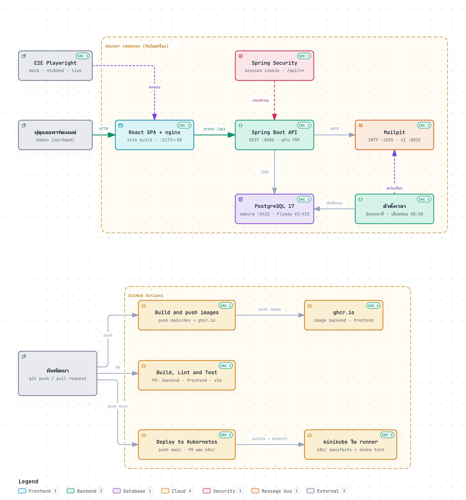

# Sakura Soul

ระบบจัดการหอพักสำหรับแอดมิน ทำเป็น semester project วิชา MUDST ปีการศึกษา 2026

## Links
- วิธีตรวจงานทีละหัวข้อ (โค้ด เทส coverage E2E pipeline และ deploy)
  [Run Document](#run-document)
- Figma
  https://www.figma.com/design/swAK0L3qmTuuxT0n956GjO/Sakura-Soul-Apartment?node-id=0-1&t=7nNdcrRfNpttSC1m-1
- User Story
  https://docs.google.com/spreadsheets/d/1xEgNkx-E_S8Y4hZU7nrSxsn_BtXuAZ-ybydJlQzR2JU/edit?usp=sharing
- ข้อตกลง API ของสัญญาเช่า
  [docs/api-contract-lease.md](docs/api-contract-lease.md)
- ข้อตกลง API ของงานซ่อมบำรุง
  [docs/api-contract-maintenance.md](docs/api-contract-maintenance.md)
- ข้อตกลง API ของใบเสร็จและเอกสาร PDF
  [docs/api-contract-billing.md](docs/api-contract-billing.md)
- แผนงานฝั่ง frontend
  [docs/frontend-workplan.md](docs/frontend-workplan.md)
  
## About

เป็นเครื่องมือฝั่งแอดมินหอพัก ไม่ใช่แอปสำหรับผู้เช่า คนที่ใช้งานคือคนดูแลหอที่ต้องรู้ว่าห้องไหนว่าง ห้องไหนมีคนอยู่ สัญญาใครหมดเมื่อไหร่ เดือนนี้ออกใบเสร็จให้ใครไปแล้วบ้าง และมีงานซ่อมค้างอยู่ห้องไหน

โจทย์ของวิชากำหนดไว้ว่าทั้งระบบต้องรันได้เองในเครื่อง ห้ามพึ่ง external API หรือ cloud service ของใคร ทุกอย่างตั้งแต่ auth ยัน database ต้องอยู่ใน stack ของเราเอง อีกข้อที่มีผลกับการออกแบบมากคือ requirement จะเปลี่ยนระหว่างเทอม เพราะฉะนั้นเราตั้งใจไม่ over-engineer ตั้งแต่แรก แต่จะลงแรงกับ test ให้พอที่ตอน refactor แล้วรู้ทันทีว่าพังตรงไหน

## Run Document

วิธีตรวจงานทีละหัวข้อ ทุกหัวข้อดูผลบน GitHub ได้ทันทีโดยไม่ต้องติดตั้งอะไร (repo เป็น public ส่วน artifact ต้องล็อกอิน GitHub
ก่อนถึงจะดาวน์โหลดได้) หรือจะ clone มารันเองก็ได้ โปรแกรมที่ต้องมีอยู่ในหัวข้อ [How to Start?](#how-to-start)
ตัวเลขที่ควรเห็นมาจาก CI run #110 (16 ต.ค. 2569)

### 1. ระบบและโค้ด

**ดูบน GitHub** โค้ดแยกเป็น `backend/` (Spring Boot), `frontend/` (React), `e2e/` (Cypress), `k8s/` (manifest)
และ `.github/workflows/` (pipeline) ผังเต็มอยู่ใน [โครงสร้าง repo](#โครงสร้าง-repo) ข้อตกลง API ระหว่างหน้าเว็บกับ backend
อยู่ใน `docs/api-contract-*.md` ตามลิงก์ข้างบน

**รันเอง**

```bash
cp .env.example .env    # แล้วใส่ POSTGRES_PASSWORD กับ APP_ADMIN_PASSWORD เป็นค่าอะไรก็ได้
docker compose up -d
```

**ควรเห็น** เปิด http://localhost:5173 ล็อกอินด้วยชื่อ `admin` กับรหัสใน `APP_ADMIN_PASSWORD` แล้วเห็น Dashboard 24 ห้อง 2 ชั้น
พร้อมข้อมูลตัวอย่าง อีเมลใบแจ้งหนี้ที่กดส่งจากหน้า Payments อยู่ที่ http://localhost:8025

### 2. ใครทำอะไร

**ดูบน GitHub** [Contributors](https://github.com/MUDST-2026-SakuraSoul-DevOps/MUDST-2026-SakuraSoul/graphs/contributors) นับ commit
ของแต่ละคน ดู commit รายคนได้ที่ `.../commits/main/?author=<ชื่อ GitHub>` เช่น
[commit ของ phirse](https://github.com/MUDST-2026-SakuraSoul-DevOps/MUDST-2026-SakuraSoul/commits/main/?author=phirse)
(ชื่อ GitHub ของทุกคนอยู่ในตาราง [ทีม](#ทีม)) และประวัติงานทีละเรื่องอยู่ใน
[PR ที่ merge แล้ว](https://github.com/MUDST-2026-SakuraSoul-DevOps/MUDST-2026-SakuraSoul/pulls?q=is%3Apr+is%3Amerged)

**รันเอง** `git shortlog -sn --no-merges main`

ชื่อ author ใน git บางคนเป็นชื่อเล่น เทียบได้ตามนี้

| ชื่อใน git | คนในทีม |
| --- | --- |
| `Nana`, `Shahalm05` | Natthanan Kantawong |
| `Pisute Chen`, `phirse` | Pisute Chen |
| `papapymie` | Pimwipa Jiranunatvong |
| `Pimdeena` | Pimpan Wadduangdee |
| `Mhiu` | Panida Srisuthangkul |
| `Wish Nakthong` | Wish Nakthong |
| `Theerawat Puvekit` | Theerawat Puvekit |

### 3. Unit และ integration test

**ดูบน GitHub** แท็บ Actions →
[Build, Lint and Test](https://github.com/MUDST-2026-SakuraSoul-DevOps/MUDST-2026-SakuraSoul/actions/workflows/build-lint-test.yml?query=branch%3Amain)
เปิดรอบล่าสุด แล้วดู job `Backend build and test` กับ `Frontend lint, test, build` รายงานเทสของ backend อยู่ใน artifact `backend-test-report`

**รันเอง** (สั่งจากรากโปรเจกต์ทีละบรรทัด)

```bash
cd backend && ./gradlew test             # Windows ใช้ gradlew.bat test · integration test ใช้ Testcontainers ต้องเปิด Docker
cd frontend && npm ci && npm run test
```

**ควรเห็น** backend 358 เคสผ่าน ไม่มีข้าม (ถ้าไม่ได้เปิด Docker ชุด integration จะถูกข้าม) · frontend 737 เคสผ่านใน 46 ไฟล์

### 4. Test coverage

**ดูบน GitHub** ในรอบเดียวกันของ Build, Lint and Test หน้า summary มีตาราง coverage ของ backend
ส่วนรายงาน HTML อยู่ใน artifact `backend-coverage` (JaCoCo) กับ `frontend-coverage` (Vitest + v8)

**รันเอง**

```bash
cd backend && ./gradlew test             # แล้วเปิด backend/build/reports/jacoco/test/html/index.html
cd frontend && npm run test:coverage     # แล้วเปิด frontend/coverage/index.html
```

**ควรเห็น** backend line 90.1% branch 77.3% (ขยับได้ราว 0.3% ระหว่างรอบ) · frontend line 82.3% branch 83.4%
(ตัดอะไรออกก่อนคิด % อธิบายไว้ในหัวข้อ [Coverage](#coverage))

### 5. E2E (Cypress)

**ดูบน GitHub** รอบเดียวกันมี job `E2E (Cypress)` (ชุด mock-api กับ stubbed-api) และ `E2E live (Cypress → Spring → PostgreSQL)`
(ชุด live-api ที่ยก PostgreSQL, Mailpit และ backend จริงขึ้นมาใน runner) รายงาน HTML อยู่ใน artifact `e2e-report` กับ `e2e-live-report`
แตก zip แล้วเปิด `reports/<ชุด>/index.html` รายการเคสทั้งหมดอยู่ใน [docs/testing/e2e-test-cases.md](docs/testing/e2e-test-cases.md)

**รันเอง** (PowerShell และต้องมี Google Chrome)

```powershell
cd frontend; npm ci; cd ..\e2e; npm ci
$env:E2E_ADMIN_PASSWORD='any'; npm test        # mock-api + stubbed-api ไม่ต้องเปิด backend

# ชุด live ต้องยก database, Mailpit และ backend ก่อน
cd ..; docker compose up -d --build --wait db mailpit backend; cd e2e
$env:E2E_ADMIN_PASSWORD='<ค่าเดียวกับ APP_ADMIN_PASSWORD ใน .env>'; npm run test:live

npm run open:mock    # เปิดหน้าจอของ Cypress ดูเบราว์เซอร์กดจริงทีละขั้น (มี open:stubbed / open:live)
```

**ควรเห็น** mock-api 15 กับ stubbed-api 2 passing (`npm test`) · live-api 17 passing (`npm run test:live`) รวม 34 เคส
รายงาน HTML ในเครื่องอยู่ที่ `e2e/cypress/reports/<ชุด>/index.html`

### 6. Pipeline as code (GitHub Actions)

**ดูบน GitHub** pipeline ทั้งหมดเป็นไฟล์อยู่ใน [.github/workflows/](.github/workflows)

| ไฟล์ | ทำงานเมื่อ | ทำอะไร | ผลแต่ละรอบ |
| --- | --- | --- | --- |
| `build-lint-test.yml` | ทุก PR และทุก push เข้า `main` | 5 job ขนานกัน backend, frontend, e2e, e2e-live และ docker (build image โดยไม่ push) | [Actions](https://github.com/MUDST-2026-SakuraSoul-DevOps/MUDST-2026-SakuraSoul/actions/workflows/build-lint-test.yml?query=branch%3Amain) |
| `docker.yml` | push เข้า `main` / `dev`, tag `v*` หรือกดสั่งเอง | build image ของ backend กับ frontend แล้ว push ขึ้น GitHub Container Registry | [Actions](https://github.com/MUDST-2026-SakuraSoul-DevOps/MUDST-2026-SakuraSoul/actions/workflows/docker.yml?query=branch%3Amain) |
| `deploy.yml` | push เข้า `main`, PR ที่แตะไฟล์ deploy หรือกดสั่งเอง | deploy ทั้ง stack ขึ้น minikube ใน runner แล้ว smoke test | [Actions](https://github.com/MUDST-2026-SakuraSoul-DevOps/MUDST-2026-SakuraSoul/actions/workflows/deploy.yml?query=branch%3Amain) |

**รันเอง** pipeline รันบน runner ของ GitHub เอง รายละเอียดของแต่ละ job อยู่ในหัวข้อ [CI/CD](#cicd)

**ควรเห็น** รอบล่าสุดบน `main` ของทั้งสาม workflow เขียว

### 7. Deploy ขึ้น Kubernetes ผ่าน CI/CD

**ดูบน GitHub** manifest อยู่ใน [k8s/](k8s) (namespace, PostgreSQL, Mailpit, backend กับ frontend อย่างละ 2 replica)
รอบของ [Deploy to Kubernetes](https://github.com/MUDST-2026-SakuraSoul-DevOps/MUDST-2026-SakuraSoul/actions/workflows/deploy.yml?query=branch%3Amain)
ยก minikube ขึ้นใน runner, build image, apply manifest แล้ว smoke test ผ่านเว็บจริง คือหน้าเว็บขึ้น, readiness ผ่าน,
`/api/rooms` ตอบ 401 ก่อนล็อกอิน, ล็อกอินได้, คำขอ 20 ครั้งของ session เดียวลง nginx pod เดียว, ได้ครบ 24 ห้อง
และอีเมลใบเสร็จถึง Mailpit

**รันเอง** ขึ้น minikube ในเครื่องตามหัวข้อ [Deploy ขึ้น Minikube](#deploy-ขึ้น-minikube)

**ควรเห็น** ทุก pod ใน namespace `sakura-soul` เป็น Running และเปิดเว็บผ่าน NodePort ได้

## Requirements

- จัดการข้อมูลผู้เช่าและสัญญาเช่า ผูกผู้เช่ากับห้อง บันทึกวันเข้า วันออก ค่าเช่า และรอบบิล (รายเดือน / รายปี)
- กันไม่ให้ห้องเดียวถูกผูกกับผู้เช่าซ้อนกันในช่วงเวลาเดียวกัน
- dashboard สถานะห้องทั้ง 24 ห้อง (ชั้นละ 12 ห้อง 2 ชั้น) ดูจบในหน้าเดียว ไม่ต้องกดเข้าไปทีละห้อง
- ออกใบเสร็จค่าเช่า ค่าน้ำ ค่าไฟ สั่งพิมพ์หรือดาวน์โหลดเป็น PDF ได้
- ออกสัญญาเช่าเป็น PDF
- บันทึกงานซ่อมบำรุงและของที่ใช้ไป เช่น เปลี่ยนหลอดไฟ ล้างแอร์ งานประปา
- log งานซ่อมแยกรายห้อง ย้อนดูได้ว่าห้องนี้เคยซ่อมอะไรมาบ้าง
- แจ้งเตือนงานซ่อมบำรุงที่ต้องทำซ้ำตามรอบ

## Tech stack

| ส่วน | ที่ใช้ |
| --- | --- |
| Frontend | React 19 + TypeScript, build ด้วย Vite, React Router |
| Styling | Tailwind CSS 4 |
| Backend | Java Spring Boot 4.1 บน Java 21 |
| Database | PostgreSQL 17 |
| Migration | Flyway |
| Build | Gradle Wrapper (Gradle 9.5.1) |
| Container | Docker, nginx เสิร์ฟหน้าเว็บและ proxy `/api` ไปที่ backend |
| Infra | Minikube / Kubernetes |
| CI/CD | GitHub Actions |
| Design | Figma |
| ออกเอกสาร PDF | openhtmltopdf + Thymeleaf + ฟอนต์ Sarabun (OFL) |
| อีเมล | Spring Mail ส่งเข้า Mailpit ใน stack ของเราเอง (ไม่ได้ส่งออกไปข้างนอก) |
| Unit / Integration test | JUnit 6 + Mockito + Testcontainers (backend), Vitest + React Testing Library (frontend) |
| E2E | Cypress + Testing Library |

## ภาพรวมสถาปัตยกรรม



ลำดับ branch ของทีม: งานแต่ละชิ้นแตก branch จาก `dev` แล้วเปิด PR กลับเข้า `dev`
พอปิดแต่ละช่วงงานค่อยรวม `dev` เข้า `main` ด้วย merge commit (ปิด Phase 1 ใน #151 และ #153)
`main` เป็น default branch และตอนนี้มีโค้ดตรงกับ `dev`

## โครงสร้าง repo

```
MUDST-2026-SakuraSoul/
├── backend/                 Spring Boot, build ด้วย Gradle Wrapper
│   └── src/main/resources/
│       └── db/migration/    Flyway migration
├── frontend/                React + TypeScript + Tailwind
│   └── src/
│       ├── api/             fetch wrapper, type ของ API, backend จำลอง
│       ├── domain/          กฎธุรกิจล้วน ๆ เช่น สัญญาเช่าทับช่วงเวลากัน
│       ├── components/      ของที่ใช้ซ้ำหลายหน้า
│       ├── dialogs/         ป็อปอัป (เช็คอิน แก้สัญญา เช็คเอาต์ งานซ่อม)
│       └── pages/           หน้าจอแต่ละหน้า ผูกกับเมนูใน sidebar
├── e2e/                     ชุดเทส end-to-end (Cypress) โมดูลแยกของตัวเอง
│   └── cypress/e2e/
│       └── live/            ชุดที่ยิงถึง Spring กับ PostgreSQL จริง
├── docs/                    ข้อตกลง API และแผนงาน
├── k8s/                     manifest สำหรับ deploy ขึ้น Minikube
├── .github/workflows/       GitHub Actions
├── docker-compose.yml
└── README.md
```

## How to Start?

ต้องมี

- JDK 21
- Node.js 22
- Docker Desktop
- Google Chrome (เฉพาะตอนรัน E2E เพราะ Cypress สั่ง `--browser chrome`)
- minikube กับ kubectl (เฉพาะตอนจะ deploy)

ไม่ต้องลง Gradle เอง repo มี wrapper มาให้แล้ว บน macOS กับ Linux ใช้ `./gradlew` บน Windows ใช้ `gradlew.bat`

ถ้ารัน `gradlew` แล้วขึ้นว่าหา Java ไม่เจอ ให้เช็ค `JAVA_HOME` ก่อนเป็นอย่างแรก บน Windows ที่เคยลง JDK ทับกันหลายรอบ
มักเจอว่า PATH ยังชี้ไปโฟลเดอร์เวอร์ชันเก่าที่ถูกลบไปแล้ว ตั้ง `JAVA_HOME` ให้ตรงกับโฟลเดอร์ JDK ที่มีอยู่จริง
แล้วเปิด terminal ใหม่

ครั้งแรกต้องตั้งรหัสผ่านก่อน ไม่มีรหัสอยู่ใน repo แล้วเพราะห้าม commit ของจริงขึ้นมา

```bash
cp .env.example .env
```

แล้วเปิด `.env` ใส่ค่าให้ `POSTGRES_PASSWORD` กับ `APP_ADMIN_PASSWORD`
สองตัวนี้ตั้งเป็นอะไรก็ได้ตอน dev แต่ต้องตั้ง ถ้าเว้นว่าง `docker compose` จะหยุด
พร้อมบอกว่าขาดตัวแปรไหน ไฟล์ `.env` ถูก gitignore ไว้ จะไม่หลุดขึ้น repo

`APP_ADMIN_PASSWORD` คือรหัสของแอดมินคนแรก ใช้ล็อกอินที่หน้าเว็บ
ระบบสร้างให้ครั้งเดียวตอนตาราง `admin_user` ยังว่าง ถ้าเคยสตาร์ตไปแล้วแล้วอยากเปลี่ยน
ต้องลบ volume ก่อนด้วย `docker compose down -v`

> **คนที่เคยรันโปรเจกต์นี้มาก่อนต้องลบ volume หนึ่งครั้ง** postgres จำรหัสจากตอน
> สร้างฐานครั้งแรกไว้ ถ้า volume `db-data` เกิดตั้งแต่ตอนที่รหัสยังอยู่ใน repo
> พอตั้งรหัสใหม่แล้ว backend จะต่อ database ไม่ติด แล้ว frontend จะไม่ขึ้นตามไปด้วย
> เพราะรอ healthcheck ของ backend
>
> ```bash
> docker compose down -v && docker compose up -d
> ```
>
> ฝั่ง minikube ก็เหมือนกัน ต้องลบ PVC ก่อน
> `kubectl delete pvc postgres-data -n sakura-soul` (หรือลบทั้ง namespace ไปเลย)

จากนั้นรันทั้ง stack ทีเดียว

```bash
docker compose up -d
```

หรือถ้ากำลังแก้โค้ดอยู่ แยกรันจะสะดวกกว่าเพราะ hot reload ทำงาน

```bash
# terminal แรก ยก postgres กับกล่องอีเมล Mailpit ขึ้นมาก่อน
docker compose up -d db mailpit

# terminal ที่สอง
cd backend
./gradlew bootRun

# terminal ที่สาม
cd frontend
npm install
npm run dev
```

หน้าเว็บที่เปิดด้วย `npm run dev` ใช้ backend จำลองในเบราว์เซอร์เป็นค่าตั้งต้น (`VITE_API_MOCK=1` ใน `frontend/.env.development`)
ถ้าอยากให้คุยกับ `bootRun` จริง ให้สร้างไฟล์ `frontend/.env.development.local` ที่มีบรรทัดเดียวว่า `VITE_API_MOCK=0`
แล้วสั่ง `npm run dev` ใหม่ ไฟล์ `.local` ถูก gitignore ไว้ จึงไม่ไปเปลี่ยนค่าของคนอื่นในทีม

ทางนี้ `bootRun` ไม่ได้เปิดโปรไฟล์ `dev` จึงไม่มีข้อมูลตัวอย่าง และถ้าไม่ได้ส่ง `APP_ADMIN_PASSWORD`
ก็จะไม่มีแอดมินคนแรกให้ล็อกอิน (แอดมินถูกสร้างเมื่อมีรหัสนี้ ไม่ว่าจะเปิดโปรไฟล์ไหน)
ถ้าอยากได้ทั้งสองอย่าง ต้องส่งรหัสกับโปรไฟล์เข้าไปเอง

ต้องส่ง `SPRING_DATASOURCE_PASSWORD` ให้ตรงกับ `POSTGRES_PASSWORD` ใน `.env` ด้วย
เพราะ `bootRun` ไม่ได้อ่าน `.env` เหมือน docker compose และ `application.yml` ไม่มีค่า default ให้แล้ว

```bash
# macOS / Linux สั่งจากในโฟลเดอร์ backend/ แล้วโหลดค่าจาก .env ที่รากโปรเจกต์มาใช้เลย
set -a; . ../.env; set +a
SPRING_DATASOURCE_PASSWORD="$POSTGRES_PASSWORD" SPRING_PROFILES_ACTIVE=dev ./gradlew bootRun

# Windows PowerShell
$env:SPRING_DATASOURCE_PASSWORD = "รหัส database ที่ตั้งไว้"
$env:APP_ADMIN_PASSWORD = "รหัสแอดมินที่ตั้งไว้"
$env:SPRING_PROFILES_ACTIVE = "dev"
.\gradlew.bat bootRun
```

ถ้าไม่ส่ง `SPRING_DATASOURCE_PASSWORD` แอปจะต่อ database ไม่ติดตั้งแต่ตอนสตาร์ต
ถ้าไม่ส่ง `APP_ADMIN_PASSWORD` แอปยังขึ้นได้ตามปกติ แต่ log จะเตือนแล้วไม่มีใครล็อกอินได้

port ที่ใช้

| service | port |
| --- | --- |
| frontend | 5173 |
| backend | 8080 |
| postgres | 5432 |
| mailpit (หน้าเว็บของกล่องอีเมล) | 8025 เปิดได้จากเครื่องนี้เท่านั้น |
| mailpit (SMTP) | 1025 เปิดได้จากเครื่องนี้เท่านั้น |

### อีเมลใบเสร็จไปอยู่ที่ไหน (Mailpit)

ปุ่ม **Send All Invoices / Send Invoices (N)** ในหน้า Payments ส่งอีเมลจริงพร้อมไฟล์ PDF ของใบเสร็จ (SSK-143)
แต่ปลายทางคือ **Mailpit** ซึ่งรันเป็น service หนึ่งใน `docker compose` ไม่ได้ส่งออกไปข้างนอก
(วิชาห้ามใช้บริการภายนอก และอีเมลของผู้เช่าตัวอย่างก็เป็นที่อยู่ปลอม) เปิดดูอีเมลทุกฉบับได้ที่
http://localhost:8025 ทั้งหัวเรื่อง เนื้อความ และไฟล์แนบ

- Mailpit ไม่ได้ตั้ง relay ไว้ อีเมลค้างอยู่ในกล่องนี้เท่านั้น และหายไปเมื่อ container ถูกสร้างใหม่
- backend ต่อ SMTP ตาม `SPRING_MAIL_HOST` กับ `SPRING_MAIL_PORT` compose ตั้งเป็น `mailpit:1025` ให้แล้ว
  ส่วน `bootRun` ใช้ค่าตั้งต้น `localhost:1025` ซึ่งคือ port ที่ compose เปิดไว้ให้ จึงต้องเปิด `mailpit` ด้วย
- ผู้ส่งคือ `Sakura Soul Apartment <billing@sakura-soul.local>` เปลี่ยนที่อยู่ได้ด้วย `APP_MAIL_FROM` ใน `.env`
- ถ้า Mailpit ไม่ได้เปิด แอปยังใช้งานได้ครบ แค่ตอนกดส่งจะขึ้นว่า
  `The mail server is not reachable. Please try again later`
- ข้อมูลตัวอย่างมีใบค้างของ Kenji Watanabe ซึ่งไม่มีอีเมล กด Send All Invoices บนฐานใหม่จะส่ง 2 ใบ ข้าม 1 ใบ
  ถ้าฐานเดิมเกิดก่อน SSK-143 ต้อง `docker compose down -v` หนึ่งครั้งถึงจะเห็นใบนี้

ปุ่ม **Schedule Auto-Billing** ตั้งให้ backend ส่งเตือนใบค้างทุกใบเดือนละครั้งเองได้ (SSK-143) ค่าเก็บในฐานข้อมูล
ไม่ใช่ในเบราว์เซอร์ งาน `BillingScheduler` ตื่นทุกนาทีตามเวลาไทย พอถึงวันกับเวลาที่ตั้งไว้ก็ส่งทุกใบที่ยัง `PENDING`
เข้า Mailpit แบบเดียวกับกด Send All Invoices ค่าตั้งต้นปิดไว้ ถ้าอยากลองเร็ว ๆ ตอนเดโม ให้ตั้งวันเป็นวันนี้
และเวลาเป็นอีกสองนาทีข้างหน้า แล้วรอดูอีเมลใน Mailpit กับ Last run ในป็อปอัป

กฎทั้งหมดของการส่ง (ใครได้ ใครถูกข้าม 503 เมื่อไหร่) กับกฎของรอบรายเดือน อยู่ในหัวข้อ "การส่งใบเสร็จทางอีเมล"
ของ [docs/api-contract-billing.md](docs/api-contract-billing.md)

### รันหน้าเว็บโดยไม่ต้องเปิด backend

หน้าจอที่ทำไปแล้ว (แดชบอร์ด ผู้เช่า สัญญาเช่า) เคยต้องรอตาราง `lease` ฝั่ง Spring
เพื่อไม่ให้งานฝั่งหน้าเว็บติดรอ เลยมี backend จำลองที่รันในเบราว์เซอร์อยู่ที่
`frontend/src/api/mockApi.ts` และเปิดไว้เป็นค่าตั้งต้นแล้วใน `frontend/.env.development`

```bash
cd frontend
npm install
npm run dev
```

แค่นี้ก็กดใช้งานได้ครบทุกหน้า ข้อมูลอยู่ใน memory กด refresh แล้วกลับไปตั้งต้น

ทุกหน้าต่อ backend จริงได้แล้ว ยกเว้น Appliances ที่ยังไม่มี endpoint (ดูหัวข้อ "ที่ยังไม่มี") ถ้าอยากให้หน้าเว็บคุยกับ backend จริง ให้สร้าง
`frontend/.env.development.local` ใส่ `VITE_API_MOCK=0` ตามที่อธิบายไว้ข้างบน
โค้ดหน้าเว็บไม่ต้องแก้สักบรรทัด รูปร่างข้อมูลที่ทั้งสองฝั่งต้องตรงกันอยู่ใน
[docs/api-contract-lease.md](docs/api-contract-lease.md) และมีเทสบังคับไว้ที่
`frontend/src/api/client.test.ts`

## ฐานข้อมูล

ใช้ PostgreSQL 17 ค่า connection อ่านจาก environment variable ทั้งหมด
`application.yml` มี default ให้เฉพาะ url กับชื่อผู้ใช้ **ไม่มี default ให้รหัสผ่าน**
ตั้งใจให้ต่อไม่ติดไปเลยถ้าลืมส่งเข้ามา ดีกว่าขึ้นได้ด้วยรหัสที่ทุกคนที่ clone ไปรู้
ค่าจริงมาจาก `.env` ผ่าน `docker-compose.yml` หรือจาก Secret ใน `k8s/`

schema คุมด้วย Flyway ไฟล์อยู่ใน `backend/src/main/resources/db/migration/` และตั้ง `ddl-auto: validate`
ไม่ใช่ `update` เหตุผลคือ requirement ของวิชาจะเปลี่ยนหลายรอบระหว่างเทอม ถ้าปล่อยให้ Hibernate แก้ schema ให้เอง
พอถึงตอนที่ข้อมูลใน dev กับใน k8s ไม่ตรงกันจะไล่ไม่ถูกว่าใครแก้อะไรไป การเขียน migration ไฟล์ต่อไฟล์เสียเวลาตอนแรกอยู่บ้าง
แต่ตอนย้อนดูมันชัดกว่ามาก ส่วน `validate` ทำให้แอปไม่ยอมสตาร์ตเลยถ้า entity กับ migration เริ่มไม่ตรงกัน
ซึ่งดีกว่าไปเจอตอน runtime

ตอนนี้มีสิบสี่ตาราง (migration V1–V15) คือ `room`, `tenant`, `apartment_config` (V3), `lease` (V4), `admin_user` (V7)
ห้าตารางของงานซ่อมบำรุงที่มาพร้อมกันใน V8 คือ `maintenance_ticket`, `supply_item`,
`supply_restock`, `maintenance_supply_usage`, `maintenance_reminder` ต่อด้วย `receipt` (V9), `room_type` (V12)
และ `billing_schedule` กับ `billing_schedule_run` (V15)
โดย `lease` เป็นตัวเชื่อมห้องกับผู้เช่า เก็บวันเริ่มวันจบ ค่าเช่า รอบบิล และอัตราค่าสาธารณูปโภคที่ล็อกไว้ตอนเซ็น
ส่วนกฎ "ห้ามปล่อยเช่าซ้อน" อยู่ที่ exclusion constraint `lease_no_overlap` ใน V4 ไม่ได้อยู่ในโค้ดฝั่งแอป

ห้าตารางของ V8 อยู่ไฟล์เดียวกันเพราะอ้างถึงกันเอง (ใบแจ้งซ่อมตัดสต็อกอุปกรณ์ และการแจ้งเตือนตามรอบ
สร้างใบแจ้งซ่อม) กฎสองข้อที่อยู่ที่ database ไม่ได้อยู่ในโค้ดคือ `supply_item_stock_ck` ที่กันสต็อกติดลบ
และ `supply_item_sku_uk` ที่กันรหัส SKU ซ้ำ ส่วนสถานะ `LOW_STOCK` ไม่ได้เก็บเป็นคอลัมน์ แต่คำนวณ
จาก `stock < min_stock` ตอนตอบ ด้วยเหตุผลเดียวกับที่สถานะห้องไม่ได้เก็บไว้ในตาราง
V13 (SSK-23) เพิ่มเพดาน `max_stock` ให้ `supply_item` พร้อม CHECK ว่าเพดานไม่ต่ำกว่าขั้นต่ำและยอดคงเหลือไม่เกินเพดาน
รายละเอียดทั้งหมดอยู่ใน [docs/api-contract-maintenance.md](docs/api-contract-maintenance.md)

ตาราง `receipt` (V9) เก็บใบเสร็จรายเดือน และ **คัดลอกอัตราทั้งชุดมาเก็บไว้ในตัวเองตอนออกใบ**
ตามข้อกำหนด US-16-S3 ทางเดินของอัตราคือ `apartment_config` → คัดลอกตอนเซ็นไปที่ `lease`
→ คัดลอกตอนออกใบไปที่ `receipt` แต่ละลูกศรคือการคัดลอกค่า ไม่ใช่การอ้างอิงกลับ
การขึ้นค่าไฟของตึกจึงไม่เปลี่ยนยอดของใบเสร็จที่ออกไปแล้วแม้แต่สตางค์เดียว
ส่วนกฎ "ห้ามออกใบเสร็จซ้ำเดือน" อยู่ที่ constraint `receipt_lease_month_uk`
รายละเอียดทั้งหมดอยู่ใน [docs/api-contract-billing.md](docs/api-contract-billing.md)

ตาราง `room` มีธง `under_maintenance` เพิ่มมาใน V5 สำหรับล็อกห้องเป็นซ่อมบำรุง (US-15) ที่เป็นธงแยก
ไม่ใช่คอลัมน์ `status` เพราะห้องที่มีผู้เช่าอยู่ก็ล็อกได้ พอปลดล็อกต้องกลับไปเป็น `OCCUPIED` เอง
สถานะห้องจึงยังคำนวณตอนตอบทุกครั้งที่ `RoomStatus.of` ที่เดียว ไม่ได้เก็บไว้ในตาราง

ส่วน V6 เพิ่มคอลัมน์ `line_id` กับ `email` ให้ตาราง `tenant` ตั้ง `phone`, `line_id`, `national_id` เป็น `NOT NULL`
และเพิ่ม constraint `tenant_national_id_uk` กันเลขบัตรประชาชนซ้ำ ตามชุดฟิลด์ของ US-03 ที่อาจารย์ตัดสินไว้
(ดูหัวข้อ US-03 ใน [docs/api-contract-lease.md](docs/api-contract-lease.md)) ต่อมา V10 ปลด `NOT NULL` ของ `line_id`
เพราะฟอร์ม Add Tenant ยังไม่มีช่องนี้ (SSK-99)

migration ที่เหลือหลังจากนั้น
- V11 เพิ่มชนิดห้อง (`room_type` ของห้อง เดิมรับแค่ `SINGLE` กับ `DOUBLE`) แล้ว V12 ย้ายค่าเช่าไปผูกกับชนิดห้อง
  ในตาราง `room_type` และลบ `room.base_rent` ทิ้ง ค่าเช่าจึงมีแหล่งเดียว (SSK-127 ตามที่อาจารย์สั่งว่าค่าเช่าฟิกตามชนิดห้อง)
- V13 เพิ่มเพดาน `max_stock` ให้คลังอุปกรณ์ (อธิบายไว้ข้างบน)
- V14 ให้ `receipt` จำว่าส่งอีเมลไปล่าสุดเมื่อไหร่และกี่ครั้ง (`last_sent_at`, `sent_count`)
- V15 เก็บค่าตั้งเวลาเตือนใบค้างรายเดือน (`billing_schedule`) กับผลของแต่ละรอบ (`billing_schedule_run`) ที่กันสอง pod ส่งซ้ำ (SSK-143)

ของเดิมไม่มีกฎห้ามเลขบัตรซ้ำ V6 จึงเปลี่ยนแถวที่ซ้ำให้เป็น `DUP-<id>` ก่อนตั้ง constraint
ไม่งั้น database ของใครที่เคยกดเพิ่มคนเดิมสองรอบจะทำให้ Flyway ล้มแล้ว backend สตาร์ตไม่ขึ้น
(`docker-compose.yml` เก็บข้อมูลไว้ใน volume `db-data` ปิด container แล้วไม่ได้หายไป)
ถ้าเจอ V6 ล้มหรือไม่อยากตามเก็บแถวที่ขึ้นต้นด้วย `DUP-` กับ `UNKNOWN-` ข้อมูล dev ทิ้งได้หมด
ด้วย `docker compose down -v` แล้ว `DevDataSeeder` จะใส่ข้อมูลตัวอย่างให้ใหม่ตอนเปิดรอบถัดไป

## การเข้าสู่ระบบ

ทุก endpoint ต้องล็อกอินก่อนแล้ว ยกเว้น `POST /api/auth/login` กับ `/actuator/health/**`
กับ `/actuator/info` ที่เปิดไว้ให้ probe ของ k8s และ healthcheck ของ docker-compose ยิงได้

ใช้ **session cookie ไม่ใช่ JWT** เพราะหน้าเว็บกับ API อยู่ origin เดียวกันทั้งตอน dev
(vite proxy) และตอน deploy (nginx proxy) cookie `JSESSIONID` จึงเดินทางเองอยู่แล้ว
ฝั่งหน้าเว็บไม่ต้องเก็บหรือแนบ token เอง รายละเอียดทั้งหมดอยู่ใน
[docs/api-contract-lease.md](docs/api-contract-lease.md) หัวข้อ "การเข้าสู่ระบบ"

**ไม่มีรหัสผ่านอยู่ใน migration** ตาราง `admin_user` (V7) สร้างมาเปล่า ๆ แอดมินคนแรก
ถูกสร้างตอนแอปสตาร์ตจาก environment variable และสร้างให้เฉพาะตอนตารางยังว่างเท่านั้น
ไม่เขียนทับของเดิม ถ้าไม่ได้ตั้ง `APP_ADMIN_PASSWORD` ไว้ ระบบจะไม่สร้างใครเลย
และขึ้น WARN ใน log บอกวิธีตั้งค่า

| ตัวแปร | ค่าตั้งต้น |
| --- | --- |
| `APP_ADMIN_USERNAME` | `admin` |
| `APP_ADMIN_PASSWORD` | ว่าง ถ้าไม่ตั้งจะล็อกอินไม่ได้ |
| `APP_ADMIN_DISPLAY_NAME` | `Administrator` |

ตอน dev ตั้งเองใน `.env` (ก๊อปจาก `.env.example`) `docker-compose.yml` อ่านไฟล์นั้นให้เอง
**ไม่มีรหัสผ่านอยู่ใน repo แล้ว** ถ้าไม่ตั้ง `APP_ADMIN_PASSWORD` compose จะหยุดพร้อมบอกชื่อตัวแปร
ส่วนบน k8s ค่ามาจาก Secret `admin-credentials` ใน `k8s/20-backend.yaml` ซึ่งเป็นค่าที่วางไว้
ต้องเปลี่ยนก่อน apply จริงทุกครั้ง เหมือนกับ `postgres-credentials`

session อายุ 8 ชั่วโมง (`server.servlet.session.timeout`) ซึ่ง US-01-S3 ระบุว่ายังต้อง
ตกลงกับทีมอีกครั้ง ตัวเลขนี้เป็นค่าที่ใช้ไปก่อน

## API ที่มีตอนนี้

ห้องกับผู้เช่า

| Method | Path | ทำอะไร |
| --- | --- | --- |
| GET | `/api/rooms` | ห้องทั้งหมด (ข้อมูลตั้งต้นมี 24 ห้อง) เรียงตามเลขห้อง มี `status`, `currentLease` และจำนวนงานซ่อมค้างมาด้วย |
| GET | `/api/rooms/{id}` | รายละเอียดห้อง |
| PATCH | `/api/rooms/{id}/status` | ล็อกห้องเป็นซ่อมบำรุงหรือปลดล็อก body `{ "status": "MAINTENANCE" }` รับแค่ `MAINTENANCE` กับ `AVAILABLE` |
| DELETE | `/api/rooms/{id}` | ลบห้องที่ไม่มีประวัติ ตอบ 204 ห้องที่เคยมีสัญญาหรือใบแจ้งซ่อมได้ 409 |
| GET | `/api/rooms/{id}/maintenance` | ประวัติงานซ่อมของห้องนี้ ใบใหม่สุดขึ้นก่อน |
| GET | `/api/tenants` | รายชื่อผู้เช่า |
| GET | `/api/tenants/{id}` | ดูผู้เช่ารายคน |
| POST | `/api/tenants` | เพิ่มผู้เช่า บังคับ `fullName`, `nationalId` (13 หลักหรือเลขพาสปอร์ต ห้ามซ้ำ), `phone` ส่วน `lineId` กับ `email` ไม่บังคับ |
| PUT | `/api/tenants/{id}` | แก้ผู้เช่าทั้งก้อน กฎเหมือนตอนเพิ่ม ช่องไม่บังคับที่ไม่ส่งมาจะกลายเป็นค่าว่าง |
| DELETE | `/api/tenants/{id}` | ลบผู้เช่าที่ไม่เคยมีสัญญา ตอบ 204 ผู้เช่าที่มีประวัติสัญญาได้ 409 ให้ปิดสัญญาแทน |

สัญญาเช่าและอัตราค่าสาธารณูปโภค

| Method | Path | ทำอะไร |
| --- | --- | --- |
| GET | `/api/leases` | รายการสัญญา กรองด้วย query `status`, `roomId`, `tenantId` ได้ |
| POST | `/api/leases` | สร้างสัญญา ตอบ 201 |
| PUT | `/api/leases/{id}` | แก้สัญญาทั้งก้อน อัตราที่ล็อกไว้ตอนเซ็นจะคงเดิมถ้าไม่ได้ส่งมาด้วย |
| POST | `/api/leases/{id}/terminate` | ปิดสัญญา body `{ "endDate": "2026-09-30" }` แล้วห้องกลับไปว่างเอง |
| GET | `/api/leases/{id}/contract.pdf` | เอกสารสัญญาเช่าเป็น PDF ไว้พิมพ์ให้สองฝ่ายเซ็น (US-11) |
| GET | `/api/receipts` | รายการใบเสร็จ ใบใหม่สุดขึ้นก่อน กรองด้วย query `leaseId`, `status`, `month` (`YYYY-MM`) ได้ |
| GET | `/api/receipts/{id}` | ใบเสร็จใบเดียว พร้อมรายการห้าบรรทัดและยอดรวม |
| POST | `/api/receipts` | ออกใบเสร็จ ตอบ 201 body `{ "leaseId", "billingMonth": "2026-09", "electricUnits", "waterUnits" }` |
| PUT | `/api/receipts/{id}` | แก้หน่วยไฟ หน่วยน้ำ และเดือนของใบที่ยังไม่ชำระ (SSK-155) คิดยอดใหม่ด้วยอัตราเดิมของใบ ใบที่ชำระแล้วได้ 409 เดือนในอนาคตได้ 400 |
| POST | `/api/receipts/{id}/pay` | บันทึกว่าชำระแล้ว body `{ "paymentMethod": "..." }` ไม่ส่ง body ก็ได้ |
| POST | `/api/receipts/send` | ส่งใบที่เลือกทางอีเมลพร้อม PDF เข้า Mailpit (SSK-143) body `{ "receiptIds": [3, 4] }` ตอบใบที่ส่งแล้วกับใบที่ข้าม |
| GET | `/api/billing-schedule` | ค่าตั้งเวลาเตือนใบค้างรายเดือน พร้อมรอบถัดไปกับผลรอบล่าสุด (SSK-143) |
| PUT | `/api/billing-schedule` | แก้ค่าตั้งเวลา body `{ "enabled": true, "dayOfMonth": 25, "sendTime": "09:00" }` งาน `BillingScheduler` ตื่นทุกนาทีแล้วส่งเมื่อถึงรอบ |
| GET | `/api/receipts/{id}/pdf` | ไฟล์ใบเสร็จเป็น PDF (US-10) |
| GET | `/api/apartment-config` | อัตราค่าไฟ น้ำ ส่วนกลาง อินเทอร์เน็ต ของทั้งตึก |
| PUT | `/api/apartment-config` | ตั้งอัตราใหม่ |

งานซ่อมบำรุง คลังอุปกรณ์ และแจ้งเตือนตามรอบ (CR-05 รายละเอียดอยู่ใน [docs/api-contract-maintenance.md](docs/api-contract-maintenance.md))

| Method | Path | ทำอะไร |
| --- | --- | --- |
| GET | `/api/maintenance` | ใบแจ้งซ่อมทั้งอพาร์ตเมนต์ ใบใหม่สุดขึ้นก่อน กรองด้วย query `status`, `roomId` ได้ |
| GET | `/api/maintenance/{id}` | ใบแจ้งซ่อมใบเดียว |
| POST | `/api/maintenance` | บันทึกงานซ่อม ตอบ 201 ของที่เบิกถูกตัดสต็อกในคำขอเดียวกัน |
| PATCH | `/api/maintenance/{id}` | แก้ทีละช่อง (สถานะ ผู้รับผิดชอบ ความสำคัญ วันนัด ค่าใช้จ่าย รายละเอียด) |
| DELETE | `/api/maintenance/{id}` | ลบใบที่เปิดผิด ตอบ 204 ได้เฉพาะใบ `OPEN` ที่แอดมินเปิดเองและยังไม่เคยเบิกของ นอกนั้นได้ 409 พร้อมเหตุผล |
| POST | `/api/maintenance/{id}/supplies` | เบิกของเพิ่มให้ใบที่เปิดไว้แล้ว body `{ "supplyId": 3, "quantity": 2 }` ใบที่ `DONE` แล้วได้ 409 ให้เปิดใบกลับเป็น In Progress ก่อน (SSK-154) |
| GET | `/api/supplies` | คลังอุปกรณ์ทั้งหมด เรียงตามชื่อ มีป้าย `IN_STOCK` / `LOW_STOCK` มาด้วย |
| GET | `/api/supplies/summary` | จำนวนรายการ จำนวนที่ใกล้หมด และจำนวนชิ้นที่เติมในเจ็ดวันล่าสุด |
| POST | `/api/supplies` | เพิ่มอุปกรณ์ ตอบ 201 รหัส SKU ซ้ำได้ 409 ไม่กรอก SKU ระบบออกให้ (`PL-004`) ต้องมี `maxStock` |
| PUT | `/api/supplies/{id}` | แก้อุปกรณ์ทั้งก้อน |
| POST | `/api/supplies/{id}/restock` | เติมของเข้าคลัง body `{ "quantity": 10 }` เป็นการบวกเพิ่ม ไม่ใช่ตั้งจำนวนใหม่ ยอดรวมต้องไม่เกิน `maxStock` |
| DELETE | `/api/supplies/{id}` | ลบของที่ยังไม่เคยถูกเบิก ตอบ 204 ของที่เคยถูกเบิกได้ 409 ให้ตั้งจำนวนเป็นศูนย์แทน |
| GET | `/api/reminders` | การแจ้งเตือนตามรอบ เรียงวันครบกำหนดใกล้สุดก่อน มีธง `overdue` มาด้วย |
| POST | `/api/reminders` | ตั้งการแจ้งเตือนใหม่ ตอบ 201 |
| PUT | `/api/reminders/{id}` | แก้ทั้งก้อน แล้วคิดวันครบกำหนดครั้งถัดไปใหม่ |
| PATCH | `/api/reminders/{id}/active` | เปิดปิดสวิตช์ body `{ "active": false }` เปิดกลับแล้วข้ามรอบที่พลาดระหว่างพัก |
| DELETE | `/api/reminders/{id}` | ลบรอบที่ยังไม่เคยสร้างใบแจ้งซ่อม ตอบ 204 รอบที่เคยสร้างใบแล้วได้ 409 ให้พักแทน |
| POST | `/api/reminders/run-due` | สั่งให้ไล่ใบที่ถึงกำหนดเดี๋ยวนี้ โดยไม่ต้องรอรอบแปดโมงเช้า |

ระบบเข้าสู่ระบบและ probe

| Method | Path | ทำอะไร |
| --- | --- | --- |
| POST | `/api/auth/login` | เข้าสู่ระบบ body `{ "username": "...", "password": "..." }` ตอบ 200 พร้อมตั้ง cookie session ให้ |
| GET | `/api/auth/me` | ตอนนี้ใครล็อกอินอยู่ ตอบ 401 ถ้ายังไม่ได้ล็อกอิน หน้าเว็บเรียกตอนเปิดแอป |
| POST | `/api/auth/logout` | ออกจากระบบ ตอบ 204 ไม่มี body |
| GET | `/actuator/health/liveness` `/readiness` | ให้ k8s ใช้เป็น probe |

error ตอบกลับเป็น `ProblemDetail` ตาม RFC 9457 ข้อความที่เอาไปโชว์ผู้ใช้ได้อยู่ในฟิลด์ `detail`
ส่วน validation error จะมีฟิลด์ `fields` บอกเพิ่มว่าช่องไหนผิดเพราะอะไร

นอกจาก endpoint ข้างบน ยังมีงานที่ระบบทำเองทุกเช้า 08:00 ตามเวลาไทย คือไล่ดูว่าการแจ้งเตือน
ตามรอบใบไหนถึงกำหนดแล้วเปิดใบแจ้งซ่อมให้อัตโนมัติ (US-14) โค้ดอยู่ที่ `maintenance/ReminderScheduler`
และเป็นเมธอดเดียวกับที่ `POST /api/reminders/run-due` เรียก

โค้ดจัดกลุ่มแบบ package-by-feature (`room/`, `tenant/`, `maintenance/`) ไม่ได้แยกเป็น `controller/ service/ repository/`
เหตุผลคือพอ requirement เปลี่ยนจะได้แก้อยู่โฟลเดอร์เดียว ไม่ต้องเปิดสามที่พร้อมกัน
ของใหม่ที่จะเพิ่มก็ทำตามรูปแบบนี้

## การออกเอกสาร PDF

ทำแล้ว มีสองเอกสารคือ **ใบเสร็จ** (US-10) กับ **สัญญาเช่าไว้เซ็น** (US-11)
รายละเอียดของ endpoint กับข้อความ error อยู่ใน [docs/api-contract-billing.md](docs/api-contract-billing.md)

วิธีที่ใช้คือ Thymeleaf render XHTML ออกมาก่อน แล้วส่งต่อให้ openhtmltopdf แปลงเป็น PDF
ที่เลือกทางนี้เพราะ layout ของใบเสร็จกับสัญญาเขียนด้วย HTML กับ CSS ได้ตรง ๆ ใครก็แก้ได้
ไม่ต้องนั่งวางพิกัดกล่องข้อความทีละอันแบบ PDF library สายวาดเอง

ของที่มีอยู่ตอนนี้

| ไฟล์ | ทำอะไร |
| --- | --- |
| `pdf/PdfRenderer.java` | ตัวกลาง รับชื่อ template กับ model แล้วคืนไฟล์ PDF เป็น byte array ฝังฟอนต์ให้เอง |
| `pdf/DocumentFormat.java` | ฟอร์แมตยอดเงินเป็นบาทพร้อมสตางค์สองตำแหน่ง (`฿3,500.00`) กับวันที่แบบ `11 Aug 2026` ให้เอกสารทุกใบเขียนเหมือนกัน |
| `pdf/PdfDocument.java` | ไฟล์ PDF พร้อมชื่อไฟล์ และตัวแปลงเป็น response แบบไฟล์แนบ |
| `templates/pdf/receipt.html` | หน้าตาใบเสร็จ |
| `templates/pdf/lease-contract.html` | หน้าตาสัญญาเช่า |
| `billing/ReceiptPdfService.java` | ประกอบ model ของใบเสร็จ |
| `lease/LeaseContractPdfService.java` | ประกอบ model ของสัญญา |

**เพิ่มเอกสารใหม่ทำยังไง** สร้าง template ใต้ `resources/templates/pdf/` แล้วเขียน service
ของ feature นั้นที่ประกอบ `Map<String, Object>` ส่งเข้า `PdfRenderer.render("pdf/ชื่อไฟล์", model)`
แล้วคืน `PdfDocument` ตัว service ควรอยู่ใน package ของ feature เอง (เหมือนที่ใบเสร็จอยู่ใน
`billing/` และสัญญาอยู่ใน `lease/`) ไม่ใช่กองไว้ใน `pdf/` ซึ่งเก็บเฉพาะเครื่องมือกลาง

สามเรื่องที่ต้องรู้ก่อนแก้ template

- **ฟอนต์ต้อง embed เข้าไปในไฟล์** ไม่ใช่แค่ตั้ง font-family ถ้าไม่ embed ตัวอักษรไทยจะหายกลายเป็นช่องว่าง
  หรือสระกับวรรณยุกต์ลอยผิดตำแหน่ง ที่หลอกคือตอนเปิดบนเครื่องตัวเองมักจะยังปกติเพราะเครื่องเรามีฟอนต์อยู่แล้ว
  ไปเปิดเครื่องอื่นถึงจะเจอ `PdfRenderer` ลงทะเบียนไว้สองน้ำหนัก (400 กับ 700) ถ้าลงแค่ 400
  ตัวหนาจะไม่ใช่ตัวหนาจริง เพราะ openhtmltopdf ไม่สังเคราะห์ให้
  `ReceiptApiTest` เปิดไฟล์ที่ generate ออกมาด้วย PDFBox แล้วเช็คชื่อฟอนต์ในทุกหน้าไว้ให้แล้ว
- **openhtmltopdf อ่าน HTML ด้วย parser ของ XML ไม่ใช่ parser ของเบราว์เซอร์** แปลว่า template
  ต้องเป็น XHTML ที่ well-formed ห้ามมี void element อย่าง `meta`, `br`, `hr`, `img` ที่ไม่ปิด tag
  และห้ามใช้ entity ของ HTML อย่าง `&nbsp;` เพราะไม่มี DTD ให้ parser แปล ต้องเขียนเป็น `&#160;`
  ทั้งสอง template ที่มีอยู่เลี่ยง void element ไปเลยทั้งใบ จะได้ไม่ต้องพึ่งว่า Thymeleaf
  serialize ออกมาแบบไหน ถ้าจะใส่ ให้ปิด tag เองทุกตัว
- **CSS ใช้ได้เท่าที่ openhtmltopdf รองรับ** flexbox กับ grid ใช้ไม่ได้ ต้องใช้ table กับ float
  ขนาดกระดาษกับขอบตั้งด้วย `@page { size: A4; margin: ...; }`

### เรื่องฟอนต์ Sarabun ไม่ใช่ TH Sarabun New

README ฉบับก่อนเขียนไว้ว่าจะใช้ **TH Sarabun New** จาก f0nt.com ตอนลงมือจริงเปลี่ยนเป็นตระกูล
**Sarabun** จาก Google Fonts แทน เป็นฟอนต์สายเดียวกัน (ออกแบบโดยคนเดียวกัน หน้าตาแทบไม่ต่าง)
ที่ต่างคือสัญญาอนุญาตของ Sarabun เป็น **SIL Open Font License 1.1** ซึ่งอนุญาตให้แจกจ่ายต่อ
พร้อมซอฟต์แวร์ได้ชัดเจนเป็นลายลักษณ์อักษร จึงคอมมิตไฟล์ฟอนต์ลง repo และฝังไปกับ Docker image
ได้โดยไม่ต้องตีความสัญญาอนุญาตเอง ซึ่งสำคัญเพราะ image ที่ใช้รันไม่มีฟอนต์ไทยติดมาสักตัว

ไฟล์อยู่ที่ `backend/src/main/resources/fonts/`

| ไฟล์ | ขนาด |
| --- | --- |
| `Sarabun-Regular.ttf` | 90,220 bytes |
| `Sarabun-Bold.ttf` | 89,804 bytes |
| `OFL.txt` | ตัวสัญญาอนุญาต **ห้ามลบ** |

## การเทส

Task เขียนไว้ว่า code review จากอาจารย์เป็น optional แต่ test ไม่ใช่ + requirement จะเปลี่ยนและ test ต้องจับ regression ให้ได้

```bash
# unit + integration test ฝั่ง backend (integration ต้องเปิด Docker ก่อน)
cd backend && ./gradlew test

# unit test ฝั่ง frontend
cd frontend && npm run test

# e2e ฝั่งหน้าเว็บ ไม่ต้องเปิด backend (ครั้งแรกต้อง npm ci ทั้ง e2e/ และ frontend/)
# ต้องตั้ง E2E_ADMIN_PASSWORD เป็นค่าอะไรก็ได้ก่อน เช่น PowerShell: $env:E2E_ADMIN_PASSWORD='any'
cd e2e && npm test

# e2e ที่ยิงถึง backend กับ PostgreSQL จริง ต้องเปิดระบบไว้ก่อน (ดูหัวข้อย่อยข้างล่าง)
cd e2e && npm run test:live
```

E2E อยู่ในโมดูล `e2e/` ของตัวเองระดับเดียวกับ `backend/` กับ `frontend/` ไม่ได้ฝังอยู่ใน
`frontend/` แล้ว เพราะมันไม่ได้ทดสอบหน้าเว็บอย่างเดียว แต่ทดสอบทั้งเส้นทางตั้งแต่
เบราว์เซอร์ไปถึงฐานข้อมูล Cypress จึงอยู่ใน `e2e/package.json` ไม่ปนกับ dependency ของตัวเว็บ

ตอนนี้มีครบสามชั้นแล้ว unit → integration → e2e

### Coverage

```bash
# backend รายงาน JaCoCo ออกมาเองหลัง ./gradlew test (finalizedBy)
cd backend && ./gradlew test
# เปิด backend/build/reports/jacoco/test/html/index.html

# frontend
cd frontend && npm run test:coverage
# เปิด frontend/coverage/index.html
```

ตัวเลขล่าสุด อ่านจาก **CI** (run #110 วันที่ 16 ต.ค. 2569) ไม่ใช่จากเครื่องใครเครื่องหนึ่ง

| ส่วน | Line | Branch | เทสที่รัน | เครื่องมือ |
|---|---:|---:|---|---|
| backend | **90.1%** | 77.3% | 358 เคส ไม่มีข้าม | JaCoCo 0.8.13 |
| frontend | **82.3%** | 83.4% | 737 เคส / 46 ไฟล์ | Vitest + v8 |

ส่วน e2e ในรอบเดียวกันผ่านครบ 34 เคส คือ `mock-api` 15, `stubbed-api` 2 และ `live-api` 17 (ดูหัวข้อชั้น e2e ข้างล่าง)

ตัวเลขของ backend ขยับได้ราว 0.3% ระหว่างรอบทั้งที่โค้ดเท่าเดิม (run #103 ได้ line 90.4% branch 77.7%)
เพราะมีเทสที่บางรอบชน constraint ของฐานข้อมูลจนวิ่งเข้า `ApiExceptionHandler.handleConstraint` บางรอบไม่ชน

ให้ยึดตัวเลขจาก CI เสมอ ตัวที่รันบนเครื่องตัวเองอาจไม่ตรง โดยเฉพาะเครื่องที่ไม่ได้เปิด Docker จะข้าม integration test
ที่ติด `@EnabledIf("dockerAvailable")` ไป ตัวเลขฝั่ง backend จึงออกมาต่ำกว่า CI ส่วน runner ของ GitHub มี Docker ให้เสมอจึงรันครบทุกครั้ง
ของ backend ดูได้จากตารางที่ job `Backend build and test` พิมพ์ไว้หน้า summary
ส่วนของ frontend อยู่ใน log ของขั้น Unit test + coverage และใน artifact `frontend-coverage`

ทั้งสองฝั่งตัดของที่ไม่ใช่ตรรกะออกก่อนคิด % แล้ว (record/DTO, คลาสผูกค่า config,
`main()`, `main.tsx`, `mockApi.ts`, ไฟล์ type ล้วน) ถ้าไม่ตัด ตัวเลขจะสูงขึ้นแต่ไม่ได้บอกอะไร
รายละเอียดว่าตัดอะไรออกบ้างอยู่ในคอมเมนต์ของ `backend/build.gradle` กับ `frontend/vite.config.ts`

ฝั่ง backend มีด่านกัน coverage ไหลลงเตรียมไว้แล้วที่ `jacocoTestCoverageVerification`
(เกณฑ์ line 70%) แต่ยังไม่ผูกเข้ากับ `check` เพราะยังไม่ได้ตกลงเกณฑ์กันทั้งทีม

**ชั้น e2e ไม่มีตัวเลข % แบบนี้** เพราะมันวัดคนละอย่าง e2e ตอบว่า "เส้นทางที่ผู้ใช้เดินจริง
ถูกพิสูจน์แล้วกี่เส้น" ไม่ใช่ "โค้ดถูกเดินผ่านกี่บรรทัด" หลักฐานของชั้นนี้คือรายงาน HTML
ของ Cypress (CI เก็บเป็น artifact `e2e-report` ของชุด mock/stubbed และ `e2e-live-report` ของชุด live
ทุกครั้ง ไม่ใช่เฉพาะตอนพัง พอแตก zip ออกมาจะมี `reports/<ชุด>/index.html` ของแต่ละชุด)
กับตารางเคสใน [docs/testing/e2e-test-cases.md](docs/testing/e2e-test-cases.md)

**ชั้น unit**

- ฝั่ง backend ดู `RoomServiceTest` ใช้ JUnit 6 กับ Mockito ปลอม repository เอา ไม่แตะ database
  ไม่ยก Spring context เทสแบบนี้รันเร็วมากและพังเฉพาะตอน logic ผิดจริง
- ฝั่ง frontend แบ่งเป็นสามชั้น `src/domain/lease.test.ts` เทสตรรกะล้วน ๆ ไม่แตะ DOM
  `src/api/client.test.ts` เทสว่ารูปร่างข้อมูลกับรหัสสถานะตรงกับที่ตกลงกับ backend ไว้
  และ `src/pages/*.test.tsx` เทสว่าผู้ใช้กดแล้วเห็นอะไร ส่วนใหญ่ยิงผ่าน backend จำลองจริง ไม่ได้ mock ทีละฟังก์ชัน
  รวม 737 เคสใน 46 ไฟล์ (16 ต.ค.)

**ชั้น integration ฝั่ง backend**

`TestcontainersConfiguration` ยก PostgreSQL ตัวจริงขึ้นมาให้ตอนเทส ไม่ใช่ฐานข้อมูลจำลอง
เทสระดับ HTTP ที่ยิง MockMvc ทะลุถึง Postgres ตัวจริงดู `LeaseApiTest`, `ApartmentConfigApiTest`
และ `ReceiptApiTest` (ตัวหลังเปิดไฟล์ PDF ที่ generate ออกมาด้วย PDFBox แล้วเช็คว่าฟอนต์ไทย
ถูก embed ไปด้วยจริง ไม่ได้เช็คแค่ว่า response เป็น `application/pdf`)
ก๊อปสามตัวนี้ไปทำต่อได้เลย ทั้งสามตัวติด `@EnabledIf("dockerAvailable")` ไว้ เครื่องที่ยังไม่ได้เปิด Docker
จะข้ามไปเฉย ๆ ไม่ทำให้ `./gradlew build` พัง ส่วน runner ของ GitHub มี Docker อยู่แล้วจึงรันจริงทุก PR

ที่ไม่ใช้ H2 เพราะ H2 กับ Postgres ต่างกันพอที่จะทำให้เทสผ่านแต่ของจริงพัง
โดยเฉพาะเรื่อง date range กับ constraint ซึ่งเป็นสองอย่างที่โปรเจกต์นี้จะได้ใช้แน่ ๆ ตอนทำสัญญาเช่า
เช่น `LeaseOverlapIntegrationTest` ที่พิสูจน์ว่าฐานข้อมูลกันสัญญาทับซ้อนห้องเดียวกันได้จริง

**ชั้น e2e ฝั่งหน้าเว็บ (Cypress)**

เปิดเบราว์เซอร์จริงแล้วกดตามที่แอดมินใช้งาน เขียนด้วย Cypress ตามที่อาจารย์กำหนด (SSK-158)
ไฟล์อยู่ใน `e2e/cypress/e2e/` แบ่งเป็นสามชุดตามว่าปลายทางของคำขอ `/api` คืออะไร

| ชุด | พอร์ต | ปลายทาง `/api` | ไฟล์ | อยู่ใน CI |
|---|---|---|---|---|
| `mock-api` | 4173 | backend จำลองในเบราว์เซอร์ (`frontend/src/api/mockApi.ts`) | `cypress/e2e/*.cy.ts` | ใช่ |
| `stubbed-api` | 4174 | ปลอมคำตอบด้วย `cy.intercept` | `cypress/e2e/*.stubbed.cy.ts` | ใช่ |
| `live-api` | 4175 | **Spring กับ PostgreSQL จริง** | `cypress/e2e/live/*.live.cy.ts` | ใช่ job `e2e-live` ยก stack ด้วย docker compose |

สองชุดแรกรันด้วย `npm test` ใน `e2e/` ไม่ต้องเปิด backend (script ยก dev server ของ Vite ให้เอง)
แต่ต้องตั้ง `E2E_ADMIN_PASSWORD` เป็นค่าอะไรก็ได้ก่อน เพราะคำสั่งล็อกอินอ่านรหัสจาก environment
ส่วน `live-api` ใน CI มี job `e2e-live` ยก PostgreSQL, Mailpit และ backend ขึ้นมาด้วย `docker-compose.yml` ให้เอง
ถ้าจะรันบนเครื่องตัวเองต้องเปิด `docker compose up -d --build --wait db mailpit backend` ไว้ก่อน แล้วสั่ง

```powershell
cd e2e
$env:E2E_ADMIN_PASSWORD='<รหัสเดียวกับ APP_ADMIN_PASSWORD>'
npm run test:live
```

รหัสแอดมินอ่านจาก environment ไม่ได้เขียนไว้ในโค้ด ถ้าไม่ตั้งเทสจะหยุดพร้อมบอกวิธีตั้ง

ที่ต้องมีชุด `live-api` เพราะ `mockApi.ts` ไม่ตรวจรูปแบบข้อมูลและรองรับทุก HTTP method
เทสที่วิ่งกับ mock จึงเขียวได้ทั้งที่ของจริงพัง บั๊กสามตัวที่เจอแบบนี้มาแล้วคือเลขบัตรประชาชน
ที่ backend ปฏิเสธ (SSK-113) endpoint แก้ไข/ลบผู้เช่าที่ตอนนั้นยังไม่มีจริง (SSK-108)
และป็อปอัปแจ้งซ่อมที่กดบันทึกแล้วไม่ยิง API (SSK-139) ทั้งสามตัวแก้แล้ว และเทสกลายเป็นตัวกัน regression

รายละเอียดของแต่ละชุด วิธีรัน วิธีเปิดหน้าจอของ Cypress ดูเบราว์เซอร์กดจริง และรายงาน HTML อยู่ใน [e2e/README.md](e2e/README.md)

ข้อมูลตัวอย่างตอน dev มาจาก `DevDataSeeder` ซึ่งทำงานเฉพาะตอนเปิดโปรไฟล์ `dev`
และ `docker-compose.yml` ตั้ง `SPRING_PROFILES_ACTIVE=dev` ไว้ให้แล้ว
ส่วน manifest ของ k8s ไม่ได้เปิด ผู้เช่าปลอมจึงไม่หลุดขึ้นไป

## CI/CD

workflow อยู่ใน `.github/workflows/`

`build-lint-test.yml` ทำงานทุก PR และทุก push เข้า main แบ่งเป็นห้า job ที่รันขนานกัน

- `backend` รัน `./gradlew build` (รวม integration test ที่ใช้ Testcontainers) เก็บ test report กับรายงาน coverage ของ JaCoCo เป็น artifact และพิมพ์ % ลงหน้า summary ของ job
- `frontend` รัน lint, unit test พร้อมวัด coverage (`npm run test:coverage`) เก็บรายงานเป็น artifact แล้ว build
- `e2e` รัน Cypress ในโฟลเดอร์ `e2e/` ชุด `mock-api` ตามด้วย `stubbed-api` (ชุดหลังรันต่อแม้ชุดแรกพัง) เก็บรายงาน HTML เป็น artifact `e2e-report` ทุกครั้ง (รูปหน้าจอมีเฉพาะเคสที่พัง)
- `e2e-live` ยก PostgreSQL, Mailpit และ backend (โปรไฟล์ `dev`) ด้วย docker compose ใน runner แล้วรัน `npm run test:live` คือชุด `live-api` ที่ยิงถึง Spring กับ PostgreSQL จริง (SSK-138) ฐานข้อมูลใหม่ทุกรอบ รหัสผ่านสุ่มตอนรัน เก็บรายงานเป็น artifact `e2e-live-report` และพิมพ์ log ของ stack ตอนพัง
- `docker` build image ของ backend กับ frontend ด้วย buildx โดยไม่ push ขึ้น registry เอาไว้จับ Dockerfile หรือ `nginx.conf` พังตั้งแต่ใน PR

runner ของ GitHub มี Docker (พร้อม compose) กับ Chrome ให้อยู่แล้ว Testcontainers, docker compose และ Cypress
เลยรันได้โดยไม่ต้องตั้งอะไรเพิ่ม (ตัวโปรแกรม Cypress เก็บ cache ไว้ข้ามรอบ) job ที่ต้องใช้รหัสผ่าน (`e2e`, `e2e-live` และ `deploy.yml`) สุ่มรหัสตอนรัน ไม่มี secret อยู่ใน repo

`docker.yml` ทำงานเมื่อ push เข้า main หรือ dev หรือ tag `v*` build image ทั้งสองตัวแล้ว push ขึ้น GHCR
ของที่ build จาก dev ได้ tag `:dev` ส่วน `:latest` ยังผูกกับ main
นอกจากนั้นยังกดสั่งเองได้จากแท็บ Actions (`workflow_dispatch`) โดยเลือก branch ไหนก็ได้ที่มีไฟล์นี้อยู่ ใช้ตอนอยากโชว์ว่า build image จาก branch ใดก็ได้จริง

`deploy.yml` ยก minikube ขึ้นมาใน runner แล้ว deploy ทั้ง stack ลงไปจริง จบด้วยการยิงเข้าเว็บ
ผ่าน NodePort เพื่อพิสูจน์ว่าเส้นทาง nginx ไป Spring Boot ไป PostgreSQL ต่อกันติดครบสาย
ไม่ได้เช็คแค่ health เพราะถ้าเช็คแค่นั้น ต่อให้ database พังก็ยังเขียวได้ จึงอ่าน `/api/rooms`
แล้วนับว่าต้องได้ครบ 24 ห้องตามที่ `V2__seed_rooms.sql` ใส่ไว้
ข้อสุดท้ายสร้างผู้เช่า สัญญา และใบเสร็จ แล้วส่งใบนั้นทางอีเมล จากนั้นเปิดกล่องของ Mailpit จากข้างใน pod
ต้องเจออีเมลอย่างน้อยหนึ่งฉบับ พิสูจน์ว่า backend ต่อ SMTP ของ Mailpit ใน cluster ได้จริง (SSK-143)

ระหว่างทางยังยิง `/api/auth/me` ซ้ำ 20 ครั้งหลังล็อกอิน ต้องได้ 200 ทุกครั้ง และนับจาก access log ของ nginx
ว่าทุกคำขอลง nginx pod เดียว สองข้อนี้กันบั๊ก session หลุดข้าม pod กลับมา (backend กับ frontend มีอย่างละ 2 pod
และ session อยู่ในหน่วยความจำของ backend แต่ละตัว) คำอธิบายทั้งสายอยู่ในคอมเมนต์ของ `k8s/30-frontend.yaml`

`deploy.yml` ทำงานเมื่อ push เข้า main เมื่อเปิด PR ที่แตะไฟล์ใน `k8s/`, `deploy.yml`, Dockerfile ทั้งสองตัว หรือ `frontend/nginx.conf`
และกดสั่งเองได้จากแท็บ Actions (`workflow_dispatch`)
PR ทั่วไปไม่ต้องยก cluster ขึ้นมาให้เสียเวลา

**สิ่งที่ workflow นี้ไม่ได้ทำ** มันไม่ได้ deploy ลง minikube บนเครื่องเรา cluster ที่ใช้เกิดใน
runner แล้วถูกทิ้งเมื่อ job จบ ที่เป็นแบบนี้เพราะ runner ของ GitHub เข้าถึงเครื่องเราไม่ได้
และโจทย์ของวิชาห้ามพึ่ง cloud service ของใคร สิ่งที่มันรับประกันคือ manifest กับ image
ใช้ deploy ได้จริง ถ้าอยากให้ deploy ลงเครื่องตัวเองอัตโนมัติด้วย ต้องตั้ง self-hosted runner
บนเครื่องนั้นแล้วเพิ่ม job ที่ระบุ `runs-on: self-hosted` ซึ่งยังไม่ได้ทำ

## Deploy ขึ้น Minikube

```bash
minikube start

# ชี้ docker client ไปที่ daemon ข้างใน minikube
eval $(minikube docker-env)

docker build -t sakura-soul-backend:local ./backend
docker build -t sakura-soul-frontend:local ./frontend

# Secret ใน k8s/ เก็บรหัสไว้เป็นค่าที่วางไว้เฉย ๆ ต้องแทนที่ก่อน apply ทุกครั้ง
# ถ้าข้ามขั้นนี้ ระบบจะขึ้นด้วยรหัสที่ใครเปิด repo ก็อ่านได้
sed -i "s/change-me-before-first-apply/$(openssl rand -hex 16)/" k8s/10-postgres.yaml
sed -i "s/change-me-before-first-apply/รหัสแอดมินที่ตั้งเอง/" k8s/20-backend.yaml

kubectl apply -k k8s/
kubectl get pods -n sakura-soul -w

minikube service frontend -n sakura-soul

# กล่องอีเมลของใบเสร็จ (Mailpit) ไม่ได้เปิดออกนอก cluster เพราะไม่มีรหัสผ่าน ใช้ port-forward แทน
# แล้วเปิด http://localhost:8025
kubectl -n sakura-soul port-forward svc/mailpit 8025:8025
```

ทุกอย่างอยู่ใน namespace `sakura-soul` ที่ `k8s/00-namespace.yaml` สร้างให้ ใช้ `-k` ก็ได้ `-f k8s/` ก็ได้
ชื่อไฟล์ขึ้นต้นด้วยตัวเลขเพื่อให้แบบ `-f` apply เรียงลำดับถูก namespace ต้องมาก่อนของอย่างอื่นเสมอ

บรรทัด `eval $(minikube docker-env)` ต้องรันก่อน `docker build` เสมอ ถ้าข้ามไป image จะไปอยู่ใน Docker ของเครื่องเรา ส่วน minikube หาไม่เจอแล้วจะขึ้น `ImagePullBackOff` ทั้งที่เพิ่ง build เสร็จหมาด ๆ อาการนี้หลอกคนมาเยอะ

บน PowerShell คำสั่งนั้นใช้ไม่ได้ ให้ใช้แทน

```powershell
minikube -p minikube docker-env | Invoke-Expression
```

ถ้า `docker-env` ใช้ไม่ได้ เช่นตอนที่ minikube ตั้ง container runtime เป็น containerd
ให้ build ด้วย docker ของเครื่องตามปกติแล้วโหลดเข้า cluster ทีหลัง วิธีนี้ใช้ได้กับทุก runtime
และเป็นวิธีที่ workflow `deploy.yml` ใช้

```bash
docker buildx build --load -t sakura-soul-backend:local ./backend
minikube image load sakura-soul-backend:local
```

และเพราะ image เป็น local ทั้งคู่ ใน manifest ต้องตั้ง `imagePullPolicy: IfNotPresent` ไว้ด้วย ไม่งั้น k8s จะพยายามไป pull จาก registry ข้างนอก

## กำหนดส่ง

| วันที่ | ต้องมี |
| --- | --- |
| 15 ส.ค. | Figma, UX/UI, user story เบื้องต้น |
| 29 ส.ค. | ปรับ Figma / UX/UI / user story และเริ่มมีโค้ดใน repo |
| 12 ก.ย. | โค้ดรันได้, unit test, pipeline as code build บน GitHub |
| 26 ก.ย. | Dockerfile, docker-compose, pipeline build docker บน GitHub |
| 17 ต.ค. | ปิด Phase 1 นำเสนอ และ deploy จาก GitHub ขึ้น k8s ได้ |
| 31 ต.ค. | ความคืบหน้า Phase 2 (Figma, user story, โค้ด) ส่วน observability ตัดออกจาก requirement แล้ว |
| 14 พ.ย. | ทุกอย่างต้องเสร็จ |

## การทำงานร่วมกัน

- ห้าม push เข้า `main` ตรง ๆ ทุกอย่างผ่าน PR
- ตั้งชื่อ branch ขึ้นต้นด้วยประเภทงาน แบบ `feat/SSK-20-reminders-backend`, `bugfix/SSK-154-block-supply-on-done-ticket`, `test/SSK-158-cypress-e2e`, `chore/test-coverage-reports`
- 1 PR ทำเรื่องเดียว รีวิวง่ายกว่าและ revert ง่ายกว่าตอนมีปัญหา
- PR ต้อง CI เขียวและมีคนในทีมอย่างน้อย 1 คน approve ก่อน merge
- commit message เขียนให้อ่านรู้เรื่องว่าทำอะไร ไม่เอา `update`, `fix bug`, `.`

## ทีม

| ชื่อ | GitHub | ดูแลส่วน |
| --- | --- | --- |
| Wish Nakthong (Wish) | @WISHERCARTs | Tech Lead |
| Pisute Chen (Chen) | @phirse | Backend |
| Natthanan Kantawong (Nana) | @natthanankan-dotcom | Frontend |
| Pimwipa Jiranunatvong (Amy) | @papapymie | Frontend + UX/UI |
| Theerawat Puvekit (Wai) | @Waiproness | UX/UI |
| Pimpan Wadduangdee (Yok) | @Pimdeena | QA / Testing |
| Panida Srisuthangkul (Mhiu) | @panidasrs | QA / Testing |

## สถานะตอนนี้

สถานะของทั้งโปรเจกต์ (16 ต.ค. 2569) โค้ดบน `main` ตรงกับ `dev`

- [x] Figma และ user story
- [x] โครง Spring Boot + Gradle Wrapper
- [x] โครง React
- [x] schema กับ migration (ห้อง ผู้เช่า สัญญา ใบเสร็จ งานซ่อม คลังอุปกรณ์)
- [x] ระบบ login (session cookie)
- [x] หน้าจอหลักต่อ API จริง (แดชบอร์ด ผู้เช่า สัญญา Payments Maintenance)
- [x] ออก PDF ใบเสร็จและสัญญาเช่า
- [x] ส่งใบแจ้งหนี้ทางอีเมล (เข้า Mailpit) และตั้งเวลาเตือนใบค้าง
- [x] Dockerfile กับ docker-compose
- [x] GitHub Actions (build/lint/test, build และ push image ขึ้น ghcr.io)
- [x] manifest สำหรับ k8s และ pipeline deploy (บน minikube ใน runner)
- [x] E2E ด้วย Cypress (mock, stubbed และ live ที่ยิงถึง Spring กับ PostgreSQL จริง อยู่ใน CI ทุก PR)

## ที่ยังไม่มี

สิ่งที่ยังค้างหลังปิด Phase 1 เรียงตามที่คิดว่าควรทำก่อนหลัง

1. **แก้โปรไฟล์แอดมิน** หน้า Account Settings แก้ชื่อ อีเมล เบอร์ และรูปได้ แต่เก็บอยู่ใน `localStorage`
   ของเบราว์เซอร์เครื่องนั้นเท่านั้น ยังไม่มี endpoint ให้เซฟกลับฐานข้อมูล (`admin_user` มีคอลัมน์ชื่อ อีเมล และเบอร์รออยู่แล้ว
   แต่ยังไม่มี `PUT /api/auth/me` ส่วนรูปยังไม่มีคอลัมน์ให้เก็บ) เปลี่ยนเครื่องหรือล้าง browser data แล้วค่าที่แก้จะหาย
2. **เครื่องใช้ไฟฟ้า (Appliance Rental)** หน้า `AppliancesPage.tsx` เป็นเฟรมจาก Figma ยังไม่มี endpoint
   ฝั่ง backend เลยสักตัว และยังไม่มีใครนิยามว่าคืออะไร ไม่ใช่คลังอุปกรณ์ซ่อมที่อยู่ในหน้า Maintenance
   ต้องถามเจ้าของ requirement ก่อนลงมือ
3. **ค่าซ่อมกับค่าเครื่องใช้ไฟฟ้าในใบเสร็จ** ใบเสร็จยังมีห้าบรรทัดตายตัว (ค่าเช่า ค่าส่วนกลาง ค่าอินเทอร์เน็ต
   ค่าไฟ ค่าน้ำ) ค่าซ่อมยังไม่เข้าบิล (SSK-144)
4. **การออกบิลใหม่อัตโนมัติ (SSK-130)** ยังทำไม่ได้ เพราะใบเสร็จต้องมีหน่วยน้ำไฟของเดือนนั้น
   และยังไม่มีตารางค่ามิเตอร์ ใบใหม่ยังออกทีละใบด้วยปุ่ม New Invoice
5. **endpoint สรุปยอด** สำหรับการ์ดสามใบบนหน้า Payments ยังไม่มี (ตอนนี้คิดจากรายการที่โหลดมา)
6. **คืนของที่เบิกผิดจากคลัง** ยังไม่มี endpoint คืนของหรือแก้จำนวนที่เบิก เป็นงาน Phase 2 (SSK-157)
7. **deploy ลง minikube บนเครื่องตัวเองอัตโนมัติ** `deploy.yml` พิสูจน์ได้ว่า manifest deploy ขึ้น cluster จริงได้
   แต่ cluster นั้นเกิดใน runner ไม่ใช่เครื่องเรา ถ้าจะให้ push แล้วของขึ้นเครื่องเราเองต้องตั้ง
   self-hosted runner เพิ่ม ดูหัวข้อ CI/CD
8. **Phase 2** (เปลี่ยนแปลงใหญ่ เช่น หลายอาคารหรืออาคารที่ปิด) ยังไม่เริ่ม
